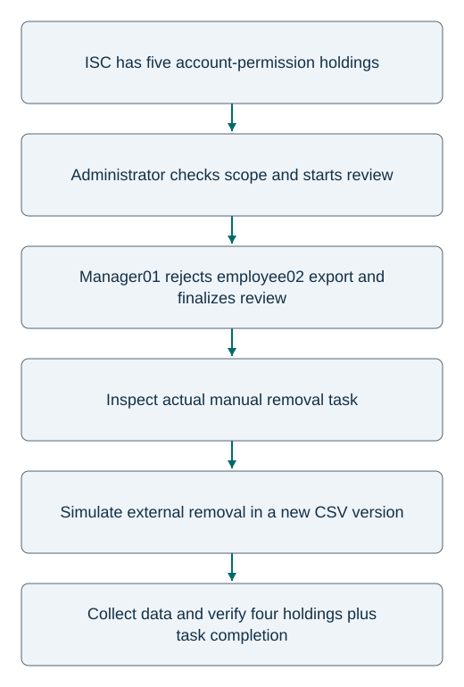

# Complete a manager review and check the CSV result

Our test employee02 still needs to read reports, but the work that required bulk export has ended. We want the manager to examine that need, keep reading access and reject export access.

A **certification campaign** organizes this review work. An assigned **certification** is a review that someone must complete within that campaign. The administrator prepares the work; the managers make the business decisions.

We'll use the CSV reporting source. A CSV file stores rows of account values under column headings. The reviews and tasks in ISC are real. The reporting application is simulated, so its access change will be represented by a deliberate file edit and a fresh collection of that data.

## Check the exact starting point

Use an authorized training administrator who can prepare campaigns and collect data from the test source. Work in the approved training tenant with these prepared objects:

- Authoritative people source: `certlab-people-csv`
- Reporting source: `certlab-reports-csv`
- People identity profile: `certlab-people-profile`

A **source** contains the configuration and collected accounts for a managed system. The people source supplies identities, which are ISC's records for the test people. Its identity profile maps people data to those records. The reporting source supplies the application accounts and permissions we will review.

The two manager users must already be able to sign in. Keep separate administrator, manager01 and manager02 browser sessions so you can tell who performed each action.

Check the live records against this starting set. The shortened employee and manager labels below all use the `certlab-` prefix in ISC.

| Account on the reporting source | Employee identity | Current permissions | Manager identity |
|---|---|---|---|
| `certlab-account01` | employee01 | Read Reports and Export Reports | manager01 |
| `certlab-account02` | employee02 | Read Reports and Export Reports | manager01 |
| `certlab-account03` | employee03 | Read Reports | manager02 |

This is three accounts and five permission holdings. A holding means one account having one permission. There are only two different permission definitions, but Read Reports is held by three accounts and Export Reports by two.

The reporting source must contain only these three accounts. Neither manager has an account there. Its recorded source owner, the person responsible for that source, must be the actual manager02 identity.

Keep the rights as individual **entitlements**, the specific access values ISC can govern. An access profile packages entitlements; a role can require a package of access for its assigned users. We are reviewing the individual rights here, so check that no package, role or automatic grant independently requires them. If the actual review unit differs, resolve the baseline before proceeding.

Keep the complete original private account file and its source template. The course's short CSV examples must be fitted to that template before upload. Do not start if another run has outstanding work that could change this same data.

## Decide what the campaign should include

The question is about permissions on the reporting source. It is not a review of every account belonging to these people.

A **campaign filter** limits the work generated for a campaign. We'll use an inclusion filter, which keeps access matching the selected criterion.

As the administrator, open **Search > Certification Campaigns > View previewed/Active > Campaign Filters > Create Filter**.

Name the new filter `certlab-reports-only` and describe its purpose. Continue to the builder, choose **Inclusion**, add one criteria group and configure:

Set the criteria type to **Source**, the operation to **Equals**, and the value to the actual `certlab-reports-csv` source.

Select the source object, not a similarly named source. Create and reopen the filter to check the saved choice.

Use only this criterion. The filter builder's criteria are joined with OR, meaning that a match to either condition can be enough. Adding “employee01” beside the source condition would not automatically mean “employee01's reporting access only.”

The source-only criterion works for this small setup because we have just inspected all three accounts on that fresh source. If it contains other accounts, fix that scope problem before generating work.

If your tenant does not offer this filter or the documented manager-campaign form, establish the matching supported route first. Do not launch an unfiltered campaign as a substitute.

## Prepare the manager campaign

Open **Admin > Certifications > Campaigns > Create New** and choose **Manager Campaign**.

Use a distinct run name such as `certlab-manager-review-run01`. For another run, use another name. Describe the purpose as reviewing the three employees' current reporting permissions.

Choose a future deadline that gives both training reviewers time to finish. Select the saved `certlab-reports-only` filter.

For this first run, keep the campaign setting that maintains access to undecided items. An **undecided item** has no review choice yet. This setting is a safeguard; our intended result still requires every item to be examined and finalized.

Choose a comment requirement that captures the reason for rejected access. Record the actual selected setting. Keep test notifications within the approved training users. If using **Disable Email Notifications**, inspect what that campaign option disables; it is not a tenant-wide switch for all task messages.

A preview generates review work from the data available at that time. It does not give reviewers their active task yet.

Check the campaign type, filter, deadline and comment settings before selecting **Preview Campaign**. Record any visible engine or Legacy label. Do not combine controls from a different campaign engine when they are absent here.

## Inspect the generated work before starting it

Wait for generation to finish, then open the campaign's preview or **Details**. Inspect the actual reviewer entries and their contents. Use the available composition report if it helps reconcile the full set.

The result must contain the five holdings in the starting table, with employee01/02 assigned to manager01 and employee03 assigned to manager02. Check the source and account for each permission, not just a familiar display name.

Manager02 is the reporting source owner, but that does not make them the manager reviewer for employee02. This is a manager campaign, so employee02's manager relationship should lead to manager01.

Check that unrelated identities, sources and rights are absent. A total of five is not enough: five wrong holdings would still be wrong.

ISC may group work into review objects. Inspect that grouping rather than assume that three employees always produce three certifications or two managers always produce two.

If the set is empty, incomplete or assigned wrongly, leave it unstarted. Check the first mismatching source record, account association, manager link or saved filter. Correcting current data does not establish that an already generated preview has changed; produce and inspect a fresh preview through the supported path.

Use a fresh preview and start it in the same training session after checking it. If the baseline or deadline has changed, establish the current set again before activation.

When it matches, select **Start Campaign**. The review work is now available to its assigned reviewers.

## Work out the decisions before clicking them

Here is the current-work evidence:

Employee01's job still includes viewing reports and downloading them in bulk. Employee02's job still includes viewing reports, but the bulk-export task has ended. Employee03 only needs to view reports.

Read Reports allows viewing. Export Reports allows downloading in bulk.

For each holding, decide whether it is needed and write a short reason. Consider employee02 carefully: the export task ending does not mean the person has left or no longer needs the account.

<details markdown="block">
<summary>Compare your decisions and reasons</summary>

| Employee | Permission | Supported decision | Reason |
|---|---|---|---|
| employee01 | Read Reports | Approve | Current work still requires report viewing. |
| employee01 | Export Reports | Approve | Current work still includes bulk export. |
| employee02 | Read Reports | Approve | Report viewing is still part of the job. |
| employee02 | Export Reports | Revoke | The work requiring bulk export has ended. |
| employee03 | Read Reports | Approve | Viewing is needed; no export holding exists to review. |

There are four approvals and one removal choice. These follow from the supplied work evidence. They are not instructions to approve a similar-looking real user's access.

</details>

## Make and finalize manager01's choices

In manager01's session, open **Certifications**, select the active assigned work and inspect the identity/access details. If the work is split across multiple certifications, inspect and finalize each one rather than assume there is a single review object.

Confirm employee01/02 and their reporting rights. **Approve** means the reviewer considers that access appropriate. **Revoke** means the reviewer decides it should be removed.

Beside each holding, select **Approve** or **Revoke** based on the work evidence. Review each item individually for this small run. For employee02's export, leave a clear reason such as “Bulk-export work has ended; report viewing is still required.” Complete any required comment submission.

Inspect all four choices across manager01's assigned work before final confirmation. A saved choice allows work to continue later; **sign-off** is the reviewer's final submission of that review.

Use **Finish** on the documented completion screen. If the interface offers a different sign-off flow, verify that flow for the recorded campaign before treating the review as finalized. Saving or exiting is not proof of sign-off.

Record the final review state and actual submission time. Do not plan to reopen a signed review to correct it. If final confirmation fails, keep it unresolved and inspect the message rather than substituting an administrator's bulk completion.

## Complete manager02's business review

In manager02's own session, open the assigned certification. Inspect employee03 and the single Read Reports holding.

Confirm the need, approve it and finalize the review through the same supported completion flow. Record the actual final state.

Manager02 has a second responsibility as the reporting source owner. That later removal task is separate from this decision about employee03.

Return to the administrator session. Check that all intended reviewer work is finalized and there are no undecided items. Inspect the campaign's resulting state. The normal fully signed path can move it to **Completed** without an administrator bulk decision.

Do not select an administrator completion action merely to make the status look finished while a reviewer remains unsigned.

## Follow the rejected holding into manual work

A **remediation** action carries out the change required by a review decision. Our manual CSV connection does not let ISC edit a live reporting account.

For employee02's rejected export, inspect the actual manual work generated by the campaign. The expected source-owner path leads to manager02, but verify the actual recipient, source, account and permission.

The following picture tracks this rejected holding. It does not describe the timing of every other review in the campaign.

<div class="diagram-scroll" role="region" aria-label="Manager review flow" tabindex="0" markdown="block">



</div>

As the actual task recipient, open **Task Manager**, or **My Tasks** on the dashboard. Open the relevant certification-removal task and inspect its details.

Match it to employee02, `certlab-account02`, `certlab-reports-csv` and Export Reports. Capture the task ID and recipient in the private run notes. If its contents differ, do not carry out a guessed change.

If no matching task appears, first check that manager01 actually finalized the removal decision and that you are looking in the correct recipient session. Record the missing work if it remains unresolved. Do not create a second campaign to conceal the gap.

## Make the simulated application change

Keep the original private account file unchanged. Make a new version for the removal result.

Remove only this holding:

```csv
certlab-account02,certlab-account02,certlab-employee02,certlab-report-export
```

That is a row in the course's four-column fixture. In your complete source-bound file, remove the row for the same account and group value while preserving its actual schema.

Keep account02's Read Reports row. Keep both account01 rows and account03's Read Reports row. The expected four-column result is supplied as `report_accounts_after_employee02_export_removal.csv`; use it as a comparison, not as a replacement for a different source template.

Do not remove Export Reports from the entitlement catalogue. The catalogue defines the permission; account01 still legitimately holds it. Removing one person's holding and deleting the permission definition are different changes.

This edit represents the action an application operator would perform in an external system. Here it is a simulation. ISC did not automatically modify the CSV or a live reporting account.

## Collect the changed data before closing the task

Use the actual task's supported file-upload step where present. Otherwise, have the authorized training administrator upload the complete revised file through the reporting source's **Account Management > Account Aggregation**.

Source ownership alone does not establish permission to use every administrator screen. Record who performed the upload. Do not grant the reviewer broad administrator rights to work around that distinction.

Upload to the reporting source, not the people source. **Aggregation** reads the file into ISC and updates the collected account information. Use one collection path and follow its aggregation through completion.

Inspect the resulting reporting accounts in ISC:

| Account | Read Reports | Export Reports |
|---|---|---|
| `certlab-account01` | Present | Present |
| `certlab-account02` | Present | Absent |
| `certlab-account03` | Present | Absent |

All three accounts must still belong to their intended employees. The result is four holdings across three accounts, with both entitlement definitions retained.

Now return to the actual manual task and select **Mark Complete** after verifying the requested simulated change. Inspect its completed state. Do not mark it complete first and treat a future file update as work already done.

Uploading account data and completing a task are separate actions. Neither is proof of a real reporting-system change in this CSV exercise.

## Put the evidence together

As the administrator, preserve the campaign's generated contents, actual reviewer choices, final confirmation records and the manual task evidence.

For a completed campaign, use **Actions > Download Reports** and generate the available sign-off and remediation reports. The sign-off evidence identifies finalized review work. The remediation evidence concerns the rejected item and its current removal state.

Generate fresh reports after collection rather than rely on a download made before the change. Match employee, source, account and permission. Read actual fields and comments; do not require a revoked row to disappear from a report that keeps historical decisions.

If the current account shows the expected four holdings but a task or report remains unresolved, record that mismatch and investigate it. Do not declare all stages complete from one successful screen.

Your run record should connect:

- The original five holdings and the checked campaign scope.
- The four approvals and one finalized removal choice.
- The actual task, recipient and requested account change.
- The original/revised file versions and completed collection.
- The four current holdings, retained permissions and final work states.

Once those checks agree, you can record that the manager review was performed in ISC and its simulated CSV removal was reconciled. Actual automatic removal from a connected system remains a different result.

## Can a completed campaign still have unfinished removal work?

Both managers have finalized their reviews, and the campaign appears in Completed. The manual task for employee02's export is still open. The latest imported account file is the original version, so ISC still shows all five holdings.

Can you report that Export Reports has been removed from employee02? What would you check or do next?

<details markdown="block">
<summary>Compare your reasoning</summary>

The reviewer work is complete, but the supplied facts do not show removal.

Match the open task to the rejected holding, prepare the new account-file version and collect the change through the supported path. Verify employee02's missing Export and retained Read, as well as the other two accounts. Then verify task completion and fresh report evidence.

Do not change the original review choice or delete the campaign to make the task disappear. The missing step is carrying out and checking the simulated change, not making another decision.

</details>

## Restore the starting set for another run

First preserve the completed campaign, reports, task details and before/after file versions. Check that no outstanding work can apply this same removal again.

Restore the complete original private reporting-account baseline and collect it on the same reporting source. Recheck three accounts and five holdings: account01 Read/Export, account02 Read/Export, account03 Read. Confirm account ownership and manager links remain correct.

There is no need to reset the people source when its data is unchanged. Keep the filter only if it still points to the intended isolated source.

Restoring employee02's export is a training-data reset. It does not reverse the signed review, erase its history or justify restoring rejected access in a real organization.

Use a distinct campaign instance for the next run. Keep this campaign and its evidence; deletion is not an access-restoration method.
