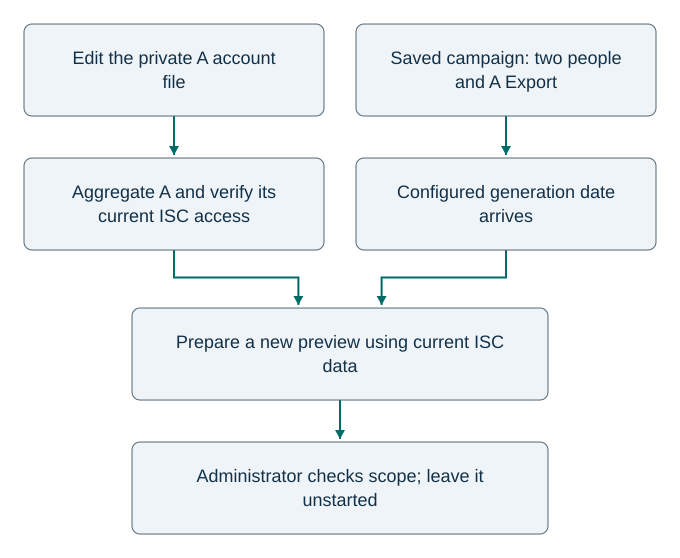

# Reuse a template and prepare the next review cycle

You need the same kind of access review again. Must you build every setting from the beginning?

A **template** is a saved campaign configuration. It lets you reuse the selections and settings you prepared. But the people, their access and their managers can change before the next review.

So there are two separate questions: are these still the right instructions, and what review work do those instructions produce now?

We'll save one configuration, change one collected permission and use the saved configuration to prepare another preview. Both previews stay unstarted.

## Start with a small, known review

A **campaign** groups assigned access reviews. A **preview** lets an administrator inspect the generated work before making it available to reviewers.

Use a training administrator who can create and schedule campaigns and upload account data to the isolated test source. Keep this work under `certlab-007`. Use an unused run name and record its actual ID. Do not change an earlier lab's saved configuration.

The two subjects are `certlab-employee01` and `certlab-employee02`. A subject is the person whose access is being checked. Both must already have `certlab-manager01` as their recorded manager.

Use source A, `certlab-reports-csv`. A **source** contains the connection settings and collected account data for a managed system. Here, a CSV file represents a simulated reporting application.

The starting A accounts must be:

| Account and identity | Read Reports | Export Reports |
|---|---|---|
| account01 / employee01 | Present | Present |
| account02 / employee02 | Present | Present |
| account03 / employee03 | Present | Absent |

The full account names are `certlab-account01`, `certlab-account02` and `certlab-account03`. The identity names use the same `certlab-` prefix.

That is three accounts and five permission holdings. A holding means one account having one permission. Read Reports allows viewing reports; Export Reports represents downloading them in bulk.

An **entitlement** is the individual access value ISC governs. An access profile packages permissions from one source. A role can require access for its assigned people. Keep these test rights as individual entitlements, outside those packages and automatic requirements.

Source B, `certlab-owner-reports-csv`, stays unchanged at four accounts and six holdings. It contains permissions with the same names, so check the source whenever you select Export Reports.

Before restoring any earlier run's data, preserve its evidence and check for unfinished campaign tasks. Resolve those tasks before continuing, so an earlier removal cannot conflict with this starting state.

Download A's actual account template and keep all its required columns. This downloaded template describes the CSV layout used to upload account data. The campaign template we will save later holds review selections and settings instead.

Put the original values from `lab-data/baselineA/report_accounts.csv` into a private copy of the account template. Verify the actual accounts, identity links, managers and individual permissions in ISC. An unchanged file on your computer is not proof of the current ISC state.

## Decide what should remain the same

The requirement is narrow: review only the A Export permission of employee01 and employee02, with manager01 responsible.

Read Reports is outside this review. Employee03, both managers as subjects and every B permission are outside it.

For the first preview, expect:

- employee01, A account01, Export Reports, manager01.
- employee02, A account02, Export Reports, manager01.

Record the actual source, identity, account and entitlement IDs privately. Familiar names help you read the work; IDs help you distinguish two different objects with matching names.

The template will preserve our selected requirement. It does not promise that both people will still hold Export when another preview is generated.

## Save a separate configuration for this run

Open **Search > Certification Campaigns > New Campaign > Identities**. Under **Using a Search Query**, select **Create Campaign**, then choose **Specific Identities that I Select**.

Find the two people with:

```text
name.exact:"certlab-employee01" OR name.exact:"certlab-employee02"
```

Here, `name.exact` matches an identity's exact name, and `OR` accepts either named person.

Inspect the returned identities, select only those two and use **+ Add To Campaign**. Check **Added to campaign**, then select **Certify Selected Identities**.

Choose **Refine Access Items**. Add only Export Reports from `certlab-reports-csv`, whose account value is `certlab-report-export`. Inspect the added access selection, then continue.

This is an explicitly added list of two identities. Searching for them helped us find them; it did not mean “include every person who may match some future query.” A campaign built with **All Identities Returned by a Query** uses a different selection choice. Inspect that choice whenever reusing a configuration.

Name this configuration `certlab-007-export-cycle-run01`. Set **Manager** as reviewer and maintain undecided access. An undecided item has no review decision.

Use the approved training notification settings and leave optional recommendations off. The **campaign owner** is the person responsible for the campaign. Record the owner shown for this configuration and their approved training contact address.

Keep these two dates separate:

- The **preview-generation date** is when ISC should prepare the review work.
- The **campaign due date** is the deadline for reviewers to finish their assigned reviews after the campaign is started.

The first preview will be generated now. Plan a future date when you can inspect the second preview; we will enter that date when scheduling the saved template later.

For now, set the reviewer due date after that planned second preview, allowing time to check and start it as well as complete the review. Today's date is not a valid campaign due date. Do not carry an expired due date into another cycle.

Choose **Generate a preview now and save as a template**. Select **Review Campaign**, check the summary and generate the preview. Do not choose the option that also starts the campaign.

## Find the saved instructions and the generated work

Inspect the first preview through **View**. Check the two expected holdings and manager01's responsibility. There must be no Read item, B permission or other subject.

Record this preview's actual campaign ID and generation time.

Now return to Search's **Certification Campaigns > Saved/Scheduled** tab and open the saved configuration. For a legacy campaign, use its separate **Legacy Saved/Scheduled** tab rather than mixing the two lists.

Compare the saved subject selection, A Export selection, reviewer, notifications and dates with your requirement. Record the saved configuration's ID separately from the generated campaign's ID. Keep the configuration unscheduled for now.

We have saved instructions and generated work. They have different jobs.

The saved configuration can prepare another instance. The first preview is the work produced for the first preparation. Preserve its actual contents as evidence; do not assume an old preview will refresh whenever account data changes.

No reviewer decision has been made. Do not approve items or sign off just to move to the next part.

## Change one permission before the next preparation

Suppose employee02 no longer needs bulk downloads. The simulated application data is updated before the next review is prepared.

Keep the original private A file. Make a new version and remove only this account-permission row:

```csv
certlab-account02,certlab-account02,certlab-employee02,certlab-report-export
```

That is the four-column fixture representation. Make the equivalent change in your complete source-template copy, preserving its required columns.

Keep account02's Read row, both account01 rows and account03's Read row. Keep both entitlement definitions. Export still exists and employee01 still holds it.

The supplied `report_accounts_after_employee02_export_removal.csv` has the expected four-column values. Use it as a comparison. It is not a replacement for a different downloaded source template.

Here, the file edit represents an independent application change between review preparations. It is not caused by either unstarted preview, and it is not a completed certification-removal task.

Upload the complete revised private file to A through the source's **Account Management > Account Aggregation**. **Aggregation** reads the account data into ISC. Follow it through successful completion. If it fails, inspect its history and error, and keep the next preparation pending until the changed data is verified.

Inspect all three A accounts afterward. Account02 must retain Read and no longer show Export; account01 must still have both rights, and account03 must retain Read. Check the identity associations too.

Inspect the identities' current access and their Search records too. Confirm that they show the changed A permissions before scheduling. The expected A total is now four holdings; B must still have six. Record the collection completion time and the checked records.

If Export is still on account02, investigate that mismatch before continuing. Check the actual uploaded file, source and completed aggregation. Do not schedule around an unresolved starting state and hope the new preview fixes it.

The two paths meet when new review work is prepared:

<div class="diagram-scroll" role="region" aria-label="Data collection and scheduled preview flow" tabindex="0" markdown="block">



</div>

The schedule prepares a preview; it does not upload your private CSV. That is why we collect the changed file and verify ISC's current access before relying on the next preparation.

## Reopen the template and schedule one preview

Return to **Search > Certification Campaigns > Saved/Scheduled**. Select this run's saved configuration, then **Schedule** on its Campaign Summary page.

Check the saved selection again: the same two identities, the same A Export entitlement and Manager reviewer.

Choose one **specific date** for this exercise. Select the intended time zone and a future preview date. Where the form offers a time, record it too. Read the displayed summary rather than calculate the run from your laptop's clock alone.

Check the preview-generation date and the campaign due date separately. If the form shows an end date, inspect what that field controls in the saved summary; its label alone does not establish the reviewer deadline. The review must not be due before its preview is ready.

Select **Next**, inspect the summary, then **Schedule**. Return to **Saved/Scheduled** and reopen the record to confirm the actual saved timing.

Write down who will inspect the generated preview and who would be responsible for starting the review. The schedule prepares a preview. An administrator still starts the campaign after checking it.

A campaign owner may receive an advance scheduling reminder. That message is not evidence that the preview was generated or the review started; inspect the actual records.

Saving this schedule proves that a configuration was saved with timing. The scheduled generation is a separate result to observe when that time arrives.

## Check what the scheduled run actually produces

At the scheduled date and time, inspect the campaign lists and generation state. Preparation can take time; follow the actual state instead of treating the scheduled moment as a completion promise.

Use **View Previewed/Active > Preview Ready** to find the resulting preview. Match the saved configuration, generated campaign ID and generation time. Distinguish it from the first preview even if their names look similar.

The expected new work contains only employee01's A Export holding, assigned to manager01.

Employee02 is still one of the explicitly selected subjects, but no longer holds the selected A permission. Their Read permission does not replace it in this targeted review.

Compare the two preparations with the current account data:

| Checkpoint | Current A holdings | Export holdings expected for the selected people |
|---|---|---|
| First preview, before the file change | Five | employee01 and employee02: two |
| Revised file saved locally, before collection | ISC still needs to be checked | A local edit alone does not establish a changed ISC set |
| Revised file collected and records verified | Four | employee01 only: one |
| New scheduled preview generated from that verified state | Four | One review holding, for employee01 |

Check the actual source, account, entitlement and reviewer. One item on B would still be wrong, even though its total is one.

Do not call that one holding “one certification” without inspecting the assigned review objects. A certification can contain multiple items.

If the new preview still contains employee02's Export, compare the current account record, collection completion time, preview generation time and saved selections. Check whether a role or access profile is changing what can be reviewed. Retain the mismatch; do not start the campaign to get past it.

If no new preview appears, check the saved schedule, its time zone, the applicable campaign list and actual generation state. A calendar entry alone does not prove generation succeeded.

Keep both instances unstarted. If the scheduled time has not arrived, record scheduling as prepared and the scheduled-generation check as still pending.

## What changes for a quarterly review?

A recurring schedule repeats preview preparation. It still needs someone to check each generated result and start that cycle's review.

To prepare quarterly previews, choose **Recurring > Annually**, then select the checkboxes for the four intended months. Here, Annually lets you define the months in a repeating yearly pattern. Selecting four months spaced three months apart gives quarterly preparations.

For calendar quarters, January, April, July and October are one possible set.

The months are only part of the configuration. Inspect the actual date, time zone, any end limit and due-date settings in the summary. Recheck those settings before relying on a later cycle; do not assume the first due date automatically rolls forward correctly.

Do not add a recurring job to this training run. The specific-date schedule already gives us a real occurrence to inspect.

There is also an easy way to generate more work than intended: generating a scheduled preview early does not remove its original scheduled occurrence. Do not assume an early preview has replaced that future run.

## An edited file is waiting on the desktop

A colleague changes the private CSV but does not upload it. The scheduled preview is then generated, and employee02's Export is still included.

They suggest deleting the Export entitlement definition so the next campaign cannot find it.

What would you check before changing anything else?

<details markdown="block">
<summary>Compare your reasoning</summary>

The local file and ISC's collected account data are different records. The campaign schedule does not upload the file.

Inspect account02's current A permissions and the last completed collection. If the changed file was not collected, finish that operation and verify the records before preparing a new preview.

Deleting the entitlement definition would change a valid permission object that employee01 still holds. It would not correct the missing collection.

Preserve the earlier preview and its times as evidence. Use a new generated instance for the corrected preparation, with the intended schedule explicitly accounted for.

</details>

## Retire this run and restore the shared data

Save the selected scope, template ID, schedule/zone, both preview IDs and times, before/after account observations and changed-file version.

First retire only this run's saved/scheduled configuration through its record in **Saved/Scheduled**. Use the offered deletion action and check the confirmation names the exact `certlab-007` configuration. Keep earlier labs' saved configurations.

Confirm it no longer appears as a future scheduled entry. Check for any already queued, generating or generated 007 instances. Removing the saved configuration is not proof that work already produced or in progress was undone. If generation is still in progress, follow it to its result and account for that instance before restoring the baseline.

Confirm every 007 instance was never started, has no reviewer decisions and has no removal work. If an instance was activated, reconcile that work before using this routine cleanup.

After preserving evidence, delete only the unused, unstarted 007 previews through **Admin > Certifications > Campaigns**, selecting the exact records, then **Delete > Delete Campaign**. Preview pages also provide deletion. Check for a later instance created during cleanup.

Restore the original complete private A account file and upload it to A through **Account Management > Account Aggregation**. Follow successful collection before inspecting the resulting ISC records. Verify three accounts and five holdings: account01 Read/Export, account02 Read/Export and account03 Read. Verify B's four accounts/six holdings and the existing identity/manager links remain unchanged.

No people source, entitlement catalogue, role or access profile needs alteration.

The useful result is that you can reuse a saved requirement, account for its schedule and check new review work against current collected access. A familiar template name is only the starting point for that check.
